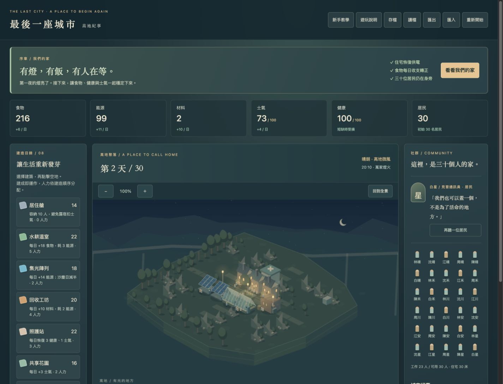

# 最後一座城市：高地紀事

**[直接遊玩網頁版](https://jiaheye135.github.io/last-city/)** — 電腦與手機皆可開啟。

原創、離線、無第三方執行依賴的城市生存 MVP。開啟 `index.html` 即可玩。

目前採保留權利聲明，並非開源授權；詳見 [LICENSE](LICENSE) 與 [第三方授權紀錄](THIRD_PARTY_NOTICES.md)。
後續 3D 原型與可移植範圍見 [開發方向](docs/DEVELOPMENT_PLAN.md)。
建議使用近期版本 Chrome、Edge、Firefox 或 Safari。

## 新版開場：第一盞燈

按「重新開始」體驗新版序章；進場時可選是否啟用逐步教學。

- 在「迎接第一個夜晚」之前，處理第 1 天事件、讓兩組集光陣列有足夠人力運作，並保持能源庫存大於 0、每日能源淨變化不小於 0。
- 第一次入夜時檢查目標；準時恢復住宅供電獲得士氣 +8，住宅窗光與街燈逐一亮起，並留下城市紀事。
- 沒趕上會士氣 −4，遊戲繼續。之後補建設施或於每日結算達成條件，仍可恢復供電，獲得一次士氣 +4。
- 亮燈後接續「明天的晚餐」，引導食物收支轉正。時間文字是敘事場景標記，不是現實時間倒數；可慢慢思考。
- 點居民姓名或「再聽一位居民」可查看近況。不同建築完工會有不同回應；缺糧、低健康與死亡也會反映於近況。
- 新美術全部以 Canvas 原創程序繪製：八種建築、殘牆、樹木、山脊、斷橋、暖色窗光、煙與居民工作動作。不使用外部圖片或音樂。
- 支援既有 v1 存檔；舊存檔若沒有序章欄位，保留原本城市進度，不追加新序章獎懲。

## 線上發布

- 使用 GitHub Pages，由 `main` 分支根目錄發布。
- 網址：https://jiaheye135.github.io/last-city/
- 更新 `main` 後，GitHub 會重新發布；不需要安裝套件或自訂建置。
- 儲存庫目前公開，但仍採保留權利聲明，並非開源授權。
- 存檔屬於各瀏覽器與網站位址。從本機／區域網路搬到此網址時，請使用遊戲的匯出與匯入功能轉移進度。

## 執行

1. 直接以瀏覽器開啟本資料夾的 `index.html`（不需安裝）。
2. 若瀏覽器對本機檔案限制儲存，可在此資料夾執行：

   python3 -m http.server 8080 --bind 127.0.0.1

   再開啟 http://127.0.0.1:8080 。結束時按 Ctrl+C。

## 手機與地圖操作

- 手機單欄顯示，觸控按鈕至少 44px 高。教學固定於下方，可捲動閱讀。
- 在地圖上單指拖曳移動、雙指縮放；亦提供放大、縮小及回到全景按鈕。縮放範圍 100%–300%。
- 地圖以外可正常上下捲動頁面；頁面限制雙指、雙擊與縮放快捷鍵造成的網頁縮放，並固定文字自動調整比例。若瀏覽器仍保留頁面放大狀態，會提供「恢復正常顯示」重新開啟頁面，之後可讀取已存的城市。地圖自己的縮放仍保留；桌面可滑鼠拖曳，Ctrl + 滾輪縮放地圖。
- 手機選建築後會定位到地圖，點空地預覽位置，再按「確認建造」；拖曳與縮放不會建造。
- 座標建造仍可使用。相機位置不影響存檔與資源規則。

## 新手教學

進場時勾選「我想跟著逐步教學操作」，或從頁首開啟八步操作教學：收支、事件、溫室、集光陣列、日結算與存檔。完成指定操作會自動進入下一步；「查看操作位置」可定位並標示目標。可隨時跳過，或從頁首重新開啟。教學使用目前城市，不重設進度、不贈送資源；讀檔／匯入會退出教學。教學期間使用手動推進，避免日期誤跑。第一夜亮燈時會先讓出畫面，按「繼續我們的故事」後再接回存檔步驟。

## 操作與規則

- 先處理第 1 天事件。選取左側建築，點地圖空地即可建造；再次點選或 Esc 取消。
- 地圖下方也有 X/Y 座標建造，範圍 1–9，支援鍵盤操作。
- 初始 30 人，3 棟住宅、水耕溫室、集光陣列、回收工坊。
- 按「結束這一天」結算生產和消耗。第 30 天完成結算才算獲勝。
- 自動推進可選 8 秒／3 秒一天，遇事件、結局或頁面隱藏自動暫停。
- 每人每天需 1 食物；額外基礎耗能為人口 / 10 向上取整。
- 淨日收益顯示於上方。人力依建造順序分配，無足夠人力的建築完全停工。
- 住宅每棟容納 10 人。8 種建築的造價、人力、效果都列在建造目錄。
- 第 15–17 天集光輸出減半；事件在 1、5、10、15、20、25 天發生。
- 食物不足：健康 −12、士氣 −7；能源不足：健康 −8、士氣 −5。
- 健康 ≤30 時每日失去一人；健康／士氣／人口歸零即失敗。
- 配給制降低 30% 食物消耗，但每日士氣 −2。
- 每日、建造、政策改變及決策後自動存檔。手動讀檔與匯入會取代目前局面。
- 儲存使用 localStorage，各瀏覽器／網址分開，並非雲端存檔。匯出 JSON 可備份搬移。
- 開場不自動覆蓋舊存檔，可先按讀檔；新局一旦建造／決策／結算便會存入同一槽。

## 入門策略（包含提示）

修復鏡片；額外建 1 溫室、1 集光陣列、1 照護站；第 3 天再建 1 共享花園。
第五天選共同育苗，食物可轉正；保留材料應對事件，注意塵幕期儲能。
不建造、拒絕調整或過度擴建都可能失敗。

## 範圍與限制

這是單地圖、固定事件的 MVP。30 位居民有獨立生死紀錄與姓名；地圖動畫會依可用工作人力對應住宅與工作建築，表現通勤、搬運與工作；尚非完整尋路、碰撞避讓、需求或人際關係模擬。沒有拆除、科技樹、外部音樂或雲端服務。
美術是原創程序繪圖；名稱是暫名。授權記錄見 THIRD_PARTY_NOTICES.md 與 LICENSE。

## 驗證

    node tests/engine.test.js
    node tests/camera.test.js
    node tests/opening.test.js
    node tests/page-controls.test.js
    node --check art.js
    node --check engine.js
    node --check game.js

核心邏輯與介面分離，測試使用 Node 內建 assert，無需下載依賴。
